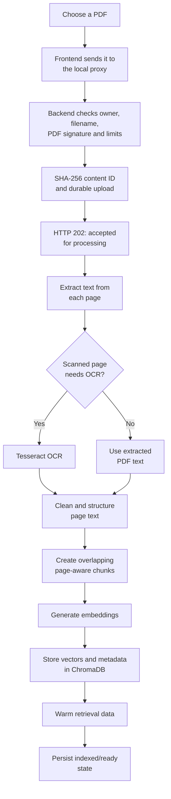
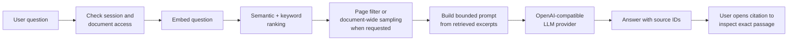

# Document Assistant

Document Assistant is a local-first workspace for asking questions about PDF files. It extracts and indexes a document, retrieves relevant page-level passages for each question, and generates an answer with citations that open the exact source passage.

This root README describes the complete project and its local workflow. Detailed product requirements are in [PRD.md](PRD.md), setup is in [SETUP.md](SETUP.md), system design is in [docs/ARCHITECTURE.md](docs/ARCHITECTURE.md), and the HTTP contract is in [docs/API.md](docs/API.md). Storage details, test status, troubleshooting, and RAG evaluation are documented in [docs/DATABASE.md](docs/DATABASE.md), [TESTING.md](TESTING.md), [TROUBLESHOOTING.md](TROUBLESHOOTING.md), and [docs/RAG_EVALUATION.md](docs/RAG_EVALUATION.md). Component-specific notes remain in [backend/README.md](backend/README.md) and [frontend/README.md](frontend/README.md).

The current account-flow and 2FA scope are documented in [docs/AUTHENTICATION_2FA_FLOW.md](docs/AUTHENTICATION_2FA_FLOW.md).

## At a glance

- Upload one PDF and follow its extraction/indexing progress.
- See upload, extraction, cleanup, chunking, embedding, index storage, and search warm-up as separate live steps.
- Ask questions after the index is ready; the backend rejects early questions until then.
- Inspect cited passages by filename and PDF page number.
- Ask for exact-page information or a document-wide summary.
- Use the app as a guest, or sign in to keep chat history in the local backend database.
- Create a local account with a stronger password and use the sign-in visibility and strength controls.
- Keep PDFs, vectors, account data, and chat history on the machine running the backend. If a remote LLM provider is configured, relevant document excerpts are sent to that provider to generate answers.

The current implementation is intended for a local or small single-machine deployment. It is PDF-only and uses one selected document per question.

## Project structure

The backend and frontend archives are designed to be extracted into the same project root:

```text
Document Assistant/
├── backend/
│   ├── app/
│   │   ├── routes/
│   │   │   ├── auth.py
│   │   │   ├── documents.py
│   │   │   └── retrieval.py
│   │   ├── services/
│   │   │   ├── auth_service.py
│   │   │   ├── document_registry.py
│   │   │   ├── embedding.py
│   │   │   ├── llm_service.py
│   │   │   ├── prompt_builder.py
│   │   │   ├── rag_service.py
│   │   │   ├── retrieval.py
│   │   │   ├── retrieval_adapter.py
│   │   │   ├── text_chunker.py
│   │   │   ├── text_cleaner.py
│   │   │   ├── text_extractor.py
│   │   │   ├── text_processor.py
│   │   │   └── vector.py
│   │   ├── config.py
│   │   └── models.py
│   ├── main.py
│   └── README.md
├── frontend/
│   ├── public/
│   │   ├── app.js
│   │   ├── favicon.svg
│   │   ├── index.html
│   │   ├── source.html
│   │   ├── source.js
│   │   └── styles.css
│   ├── .env.example
│   ├── .gitignore
│   ├── package.json
│   ├── server.mjs
│   └── README.md
├── docs/
│   ├── API.md
│   ├── ARCHITECTURE.md
│   ├── DATABASE.md
│   └── RAG_EVALUATION.md
├── myenv/                         # Local Python virtual environment; create locally
├── storage/                       # Created locally for uploads, vector DB, and SQLite
│   ├── uploads/
│   ├── vector_db/
│   ├── accounts.sqlite3
│   └── document_registry.sqlite3
├── .env                           # Backend settings; create locally, never commit
├── .env.example                   # Safe backend configuration template
├── .gitignore
├── LICENSE
├── PRD.md
├── pyproject.toml                 # Python package metadata and package discovery
├── README.md
├── requirements.txt               # Python runtime dependencies
├── SETUP.md
├── TESTING.md
└── TROUBLESHOOTING.md
```

`myenv/`, `.env`, and `storage/` are machine-specific and are not distributed in the source archives. The backend creates storage directories and databases as needed. Keep private PDFs, credentials, local databases, and virtual environments out of public source control.

## Technology stack

| Area | Technology | What it does |
|---|---|---|
| Backend API | Python 3.10+, FastAPI, Starlette, Pydantic | HTTP API, request validation, sessions, upload limits, and API docs in development |
| PDF extraction | PyMuPDF | Reads PDF text and page layout; detects pages that need OCR |
| OCR | Tesseract OCR (system application) | Reads scanned/image-only pages when needed; not installed by pip |
| Text preparation | Project services | Cleans and structures extracted text, identifies headings, and creates page-aware chunks |
| Embeddings | Sentence Transformers, PyTorch, `BAAI/bge-small-en-v1.5` | Encodes document chunks and questions as 384-dimensional vectors |
| Vector search | ChromaDB, persistent local collection | Stores chunk text, page metadata, and embeddings for semantic search |
| Retrieval and answers | Hybrid semantic/keyword retrieval, RAG prompt builder, OpenAI-compatible chat completions | Finds passages, prepares grounded context, and generates cited answers |
| Account and document metadata | SQLite, Python `scrypt` | Stores accounts, hashed sessions, chats, document states, and access grants |
| Frontend | HTML, CSS, browser JavaScript | Responsive document upload and chat workspace; no frontend framework or npm runtime dependencies |
| Frontend server | Node.js 18+ built-in HTTP modules | Serves static files and proxies allowed API requests without exposing the backend token to browser code |

`requirements.txt` lists Python package names without exact version pins. For a reproducible production deployment, validate the supported Python/OS combination and generate a tested lock file. The first embedding-model use may download model files, so initial setup requires network access unless the model is already cached.

## How the application works

### 1. Upload and indexing



An upload response of **202 Accepted means the file was accepted for background processing; it does not mean the document is ready**. The frontend polls the status endpoint and only enables questions after extraction, chunking, embeddings, vector storage, and retrieval warm-up succeed. A failure is saved as a failed state and shown in the upload panel.

The current upload guard accepts PDF files up to 10 MB and 500 pages. OCR and extracted-text processing have additional resource limits. Chunks are currently built at approximately 1,000 characters with 100 characters of overlap. Re-uploading identical bytes can reuse the content-hash index while access remains owner-scoped.

### 2. Question answering



- Ordinary questions use semantic and keyword evidence from the selected document.
- Page questions are restricted to the requested page(s).
- Overview and summary prompts sample passages across the document rather than only the highest-scoring neighborhood.
- The answer should disclose when the document does not support a requested fact. Citations identify the chunks used and resolve to the exact page text.
- Greetings may be handled without searching the PDF, so unrelated sources are not attached.
- Extracted PDF content is treated as untrusted input to the model.

Indexing is performed once per document; later questions reuse the persisted vectors and warm in-process retrieval data. Each question still needs query embedding, retrieval, and an LLM call, so end-to-end latency depends on the local model/device and the configured provider.

## Setup and run (Windows PowerShell)

Extract `backend.zip` and `frontend.zip` into the same empty or existing project root. Do not extract `backend.zip` inside a second `backend/` directory. The expected root contains sibling `backend/` and `frontend/` directories plus `PRD.md`, `README.md`, and `requirements.txt`.

### 1. Create or activate the Python environment

From the project root:

```powershell
python -m venv myenv                 # Run once if myenv does not already exist
.\myenv\Scripts\Activate.ps1
python -m pip install --upgrade pip
python -m pip install -r requirements.txt
```

If PowerShell blocks activation due to local policy, use the environment's Python directly instead:

```powershell
.\myenv\Scripts\python.exe -m pip install -r requirements.txt
```

### 2. Configure the backend

Create `.env` in the **project root** (beside `backend/`):

```env
APP_ENV=development
API_ACCESS_TOKEN=

LLM_BASE_URL=https://api.openai.com/v1
LLM_MODEL=your-provider-model-name
LLM_API_KEY=your-provider-api-key
```

For local development, `APP_ENV=development` permits an empty `API_ACCESS_TOKEN`. Keep both servers bound to `127.0.0.1`. When using a token, set a strong token of at least 32 ASCII characters in the backend `.env` and set the **same value** in `frontend/.env`. Generate one with:

```powershell
python -c "import secrets; print(secrets.token_urlsafe(48))"
```

Outside development, the backend requires `API_ACCESS_TOKEN`. Do not commit either `.env` file or share provider keys.

### 3. Install Tesseract only if scanned PDFs need OCR

Tesseract is an operating-system application, not a Python package, so it is intentionally absent from `requirements.txt`. PDFs with selectable/searchable text do not need it.

- **Windows:** install a Tesseract build from the [UB Mannheim Windows builds](https://github.com/UB-Mannheim/tesseract/wiki), ensure its install directory is on `PATH`, then close and reopen PowerShell and restart the backend. Check with `tesseract --version`.
- **macOS:** `brew install tesseract`.
- **Ubuntu/Debian:** `sudo apt install tesseract-ocr`.

The default OCR language is English (`eng`). Install the needed Tesseract language data and set `OCR_LANGUAGE` (for example, `eng+hin`) when processing other languages. If OCR is needed but unavailable, indexing fails with a setup message; install/fix Tesseract and retry.

### 4. Start the backend

From the **project root**, with the virtual environment active:

```powershell
$env:APP_ENV = "development"
python -m uvicorn backend.main:app --reload --host 127.0.0.1 --port 8000
```

The base health endpoint is [http://127.0.0.1:8000/](http://127.0.0.1:8000/). Interactive API docs are available at [http://127.0.0.1:8000/docs](http://127.0.0.1:8000/docs) only when `APP_ENV=development`.

### 5. Configure and start the frontend

Open a second PowerShell window:

```powershell
cd "<project-root>\frontend"
Copy-Item .env.example .env       # Run once; edit .env if a backend token is configured
npm start
```

Open [http://127.0.0.1:4173](http://127.0.0.1:4173). The frontend `.env` controls the backend URL, frontend bind address/port, and the server-side proxy token. The browser never receives the backend bearer token. The frontend has no packages to install; Node.js 18 or newer is required.

### Important Windows embedding-runtime issue

The local embedding stack requires PyTorch. The project owner encountered Windows Application Control blocking `torch_python.dll` with `WinError 4551`. Setting `EMBEDDING_DEVICE=cpu` does **not** fix a policy that blocks the PyTorch DLL itself. Use a trusted/approved Python environment and ask the device administrator to allow the approved PyTorch runtime; then restart the backend and retry indexing. Do not attempt to bypass the device's application-control policy. The UI reports this failure instead of showing a false ready state.

## Configuration reference

All backend environment values can be set in the project-root `.env` or in the process environment. Defaults and full configuration details are documented in [backend/README.md](backend/README.md).

| Variable | Default | Purpose |
|---|---|---|
| `APP_ENV` | `production` | `development`, `test`, or `production`; development enables API docs and permits an unset API token |
| `API_ACCESS_TOKEN` | empty | Server-side bearer-token protection; required outside development |
| `LLM_BASE_URL` | `https://api.openai.com/v1` | OpenAI-compatible chat-completions provider base URL |
| `LLM_MODEL` | unset | Model identifier accepted by the configured provider |
| `LLM_API_KEY` | empty | Provider key; can also use provider-specific `OPENAI_API_KEY` or `NVIDIA_API_KEY` where supported |
| `LLM_TIMEOUT_SECONDS` | `60` | Provider request timeout |
| `EMBEDDING_MODEL_NAME` | `BAAI/bge-small-en-v1.5` | Sentence Transformers model used for document and query embeddings |
| `EMBEDDING_DEVICE` | `auto` | `auto`, `cpu`, or `cuda` selection for PyTorch |
| `EMBEDDING_EXPECTED_DIMENSION` | `384` | Must match the selected embedding model; changing models requires a deliberate re-index |
| `VECTOR_DB_PATH` | `storage/vector_db` | Persistent ChromaDB directory |
| `VECTOR_DB_COLLECTION` | `documents` | ChromaDB collection name |
| `RETRIEVAL_DEFAULT_TOP_K` | `5` | Default number of retrieved passages |
| `RETRIEVAL_MAX_TOP_K` | `50` | Maximum retrieval count |
| `PDF_MAX_PAGES` | `500` | Maximum accepted PDF page count |
| `OCR_LANGUAGE` | `eng` | Tesseract language data used for scanned pages |
| `SESSION_COOKIE_SECURE` | `false` | Set to `true` when the frontend is served over HTTPS |

Frontend settings live in `frontend/.env`, not in the backend `.env`:

| Variable | Default | Purpose |
|---|---|---|
| `BACKEND_URL` | `http://127.0.0.1:8000` | Backend address used by the Node proxy |
| `API_ACCESS_TOKEN` | empty | Same token as backend when bearer protection is enabled |
| `FRONTEND_HOST` | `127.0.0.1` | Local bind address; keep loopback for single-user use |
| `FRONTEND_PORT` | `4173` | Local web UI port |

## API overview

The frontend's Node server proxies a limited set of paths to the backend. API token protection applies to `/documents`, `/auth`, and `/chats` when configured. Document operations also require the session cookie created by guest start or account sign-in.

| Method | Backend path | Purpose |
|---|---|---|
| `GET` | `/` | Health response |
| `GET` | `/auth/session` | Read current guest/account session |
| `POST` | `/auth/guest` | Start/reuse a guest session |
| `POST` | `/auth/signup` | Create local account and sign in |
| `POST` | `/auth/login` | Sign in and rotate session |
| `POST` | `/auth/logout` | Invalidate session |
| `GET` | `/chats` | List saved account chats |
| `PUT` | `/chats/{chat_id}` | Save/update account chat |
| `DELETE` | `/chats/{chat_id}` | Delete saved chat (does not delete indexed PDF) |
| `POST` | `/documents/upload` | Validate and accept a PDF for asynchronous indexing; returns `202` |
| `GET` | `/documents/{document_id}/status` | Read durable indexing status, stage, progress, metrics, and safe error |
| `POST` | `/documents/search` | Return ranked passages for an indexed document |
| `POST` | `/documents/ask` | Retrieve passages and generate an answer with source metadata |
| `GET` | `/documents/{document_id}/chunks/{chunk_id}` | Load the exact cited passage |

Typical response meanings: `202` upload accepted; `401` missing/invalid API token or session; `404` document is not available to this owner; `409` indexing is incomplete; `413` request/file too large; `422` invalid input/PDF; `429` upload capacity or rate limit; `503` an underlying retrieval, vector, or LLM service is unavailable. The exact request and response schemas are in development API docs and [backend/README.md](backend/README.md).

## Data lifecycle and local storage

| Location | Contents |
|---|---|
| `storage/uploads/` | Validated PDFs stored by SHA-256 content ID |
| `storage/vector_db/` | Persistent ChromaDB vectors, chunks, and metadata |
| `storage/accounts.sqlite3` | Local accounts, hashed sessions, login attempt limits, and saved chats |
| `storage/document_registry.sqlite3` | Document state, filenames, indexing metrics, and owner access grants |
| Browser memory | Guest conversation history; not restored after closing the page |

Back up the entire `storage/` directory to preserve local accounts, indexed PDFs, vectors, and saved chats. Deleting a chat does not delete its PDF or vector index; there is currently no document-deletion endpoint. Guest chats are temporary. Account sessions last 14 days; guest sessions last 24 hours.

## Security and privacy

- The backend and frontend bind to loopback by default. Keep them local unless a deployment is explicitly hardened.
- The frontend server holds the backend bearer token and proxies requests; do not put the backend token in browser JavaScript or local storage.
- Sessions are random, HttpOnly, SameSite cookies; backend storage keeps session-token hashes. Account passwords are stored using scrypt hashes.
- Every document status, search, ask, and source request checks the current owner. Unauthorized document access does not reveal whether another user's document exists.
- Uploads enforce PDF signature/type and size limits; HTTP request body limits and a two-upload concurrency limit are applied.
- The LLM client requires HTTPS for non-local providers, rejects redirects, and bounds response size.
- PDF text is untrusted prompt data. Still, AI answers can be wrong; check important claims in the source PDF.
- When a remote LLM is configured, retrieved document excerpts are sent to that provider. Review the provider's data handling policy before uploading sensitive documents.
- New local accounts require a 12–128 character password with a letter, number, and special character. Existing accounts can still sign in with their current password. The current product does not implement 2FA, password reset, or email verification; choose a factor and recovery policy before adding those flows.

## Troubleshooting

### Upload says accepted, but asking is unavailable

`202 Accepted` only confirms the file was saved and queued. Watch the upload tracker until it says ready. If indexing fails, the message includes the stage-specific next step. The API returns `409` for ask/search until the status is `indexed`.

### PyTorch error: `WinError 4551` or `torch_python.dll` blocked

Windows Application Control is preventing the native PyTorch library from loading. Reinstalling packages or selecting CPU mode may not resolve a device policy block. Ask the device administrator to allow the trusted PyTorch runtime or use an approved Python environment. Restart the backend after the policy/environment is corrected, then upload the PDF again.

### OCR or Tesseract error

Only scanned/image-only pages need OCR. Install Tesseract once, add it to `PATH`, verify `tesseract --version`, reopen the terminal, restart the backend, and retry. For non-English scans, install the matching language data and set `OCR_LANGUAGE`. Selectable-text PDFs should process without Tesseract.

### Model download or LLM configuration error

The BGE embedding model downloads on first use and may need network access. Configure `LLM_BASE_URL`, `LLM_MODEL`, and the provider key in the backend `.env`; the LLM model is separate from the embedding model. An indexed document can remain ready even when the answer-generation provider is temporarily unavailable.

### Frontend reports backend offline or token error

Check that the backend is running on the `BACKEND_URL` in `frontend/.env`. If a bearer token is configured, verify that `API_ACCESS_TOKEN` matches in both `.env` files. Keep both servers on `127.0.0.1` for local use.

## Current scope and known limitations

- PDF files only; one document per question; no cross-document retrieval.
- Default embedding and OCR setup is English-oriented.
- Local PyTorch/Sentence Transformers are required for embeddings; Windows application-control policies may block native libraries.
- SQLite and persistent local ChromaDB target a single node, and document locks/upload limits are process-local. Run a single Uvicorn worker; multi-worker/multi-host deployment needs shared job coordination and storage.
- No document deletion, guest-chat persistence, password reset, email verification, or hosted account service.
- OCR may not preserve handwriting, complex tables, formulas, or unusual reading order perfectly.
- Answer usefulness depends on PDF extraction quality, retrieval quality, and the configured LLM. Validate citations and important claims against the original document.

## Further reading

- [Product requirements and acceptance criteria](PRD.md)
- [System architecture and data flow](docs/ARCHITECTURE.md)
- [Installation and local run guide](SETUP.md)
- [HTTP API reference and examples](docs/API.md)
- [SQLite, ChromaDB, and backup details](docs/DATABASE.md)
- [Testing status and manual verification checklist](TESTING.md)
- [Troubleshooting guide](TROUBLESHOOTING.md)
- [RAG quality evaluation plan](docs/RAG_EVALUATION.md)
- [Backend architecture, full settings, endpoint details, and security notes](backend/README.md)
- [Frontend workflow, account behavior, and UI notes](frontend/README.md)
- [MIT License](LICENSE)
