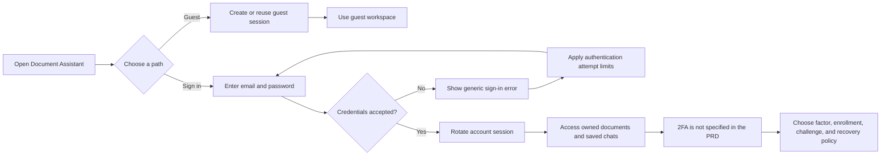

# Account authentication and 2FA scope

This flow follows the current account requirements in `PRD.md`. The service supports guest sessions, local email-and-password signup and sign-in, session rotation, and account-owned saved chats. It does not currently implement two-factor authentication.

The Figma version is available at [Document Assistant 2FA Scope Gap](https://www.figma.com/board/fJcndbtVqCzCQfXvdLzEVr).

## Open decisions before implementing 2FA

- Which factor is supported (for example, an authenticator app or a trusted email provider).
- Whether enrollment is optional or required, and when it is offered.
- How challenges expire, how repeated failures are limited, and what happens to active sessions.
- How users recover access if they lose the second factor.
- What operational secrets, delivery services, and account policies are available.

Until these decisions are made, sign-in completes after password verification. The UI and backend do not pretend that a second-factor challenge is active.
